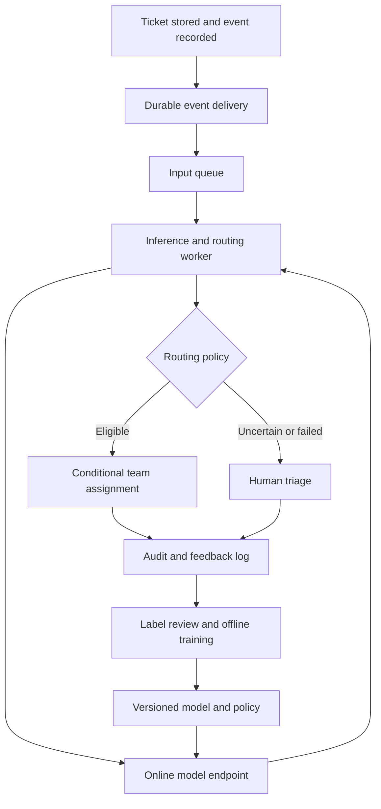

# SD-001 — Ticket classifier with human fallback: agent solution

- Author: Codex
- Written: October 31, 2026, after the candidate's interview
- Basis: [problem](problem-description.md) and interviewer-established requirements
- Provenance: original worked design informed by the discussion; not a blind attempt or official company answer
- Status: reference design, not an implemented or benchmarked service

## 1. Scope and success

Assign an incoming ticket to one of four existing support teams or defer it to
human triage. Do not generate replies. Reuse ticket storage, identity, staff
inboxes and assignment APIs. Human triage is a workflow state, not a fifth
business category. Routing never grants access to sensitive content: authorization
must independently control which staff can view a ticket.

Optimize correct automated routing subject to harmful-misroute limits, human
capacity and the two-second latency target. Agree on error costs with support
owners before choosing thresholds. Report:

- Automated coverage: fraction of eligible tickets routed automatically.
- Error rate among automatically routed tickets, including per-destination precision.
- Per-class recall and the confusion matrix on all labeled classifier predictions.
- Actual Billing tickets incorrectly auto-routed elsewhere, divided by all actual Billing tickets.
- Human-triage volume, backlog age, time to correct assignment and reroute rate.
- End-to-end p95 automatic routing latency, availability and cost per ticket.

Deferrals are not correct automatic predictions or harmful misroutes by default.
Report them separately, including by true class. Delays in triage can still harm
customers. Lack of a human reroute does not prove a prediction was correct.

## 2. Start with a measurable baseline

Use subject plus body, with identical versioned preprocessing in training and
serving. Remove reply boilerplate and protect personal information without
blindly stripping useful error codes. Exclude final assignment and post-resolution
text from model inputs: they were unavailable at arrival.

Start with TF-IDF plus a multiclass logistic-regression classifier. Compare it
with frozen text embeddings plus a lightweight classifier. Embeddings are a
reasonable candidate, but must earn their additional latency and operational cost.
Neither approach requires an LLM or a new vector database for online search.

Use the last year of data, but verify that final team assignment represents the
intended label. Document ambiguous cases and missing labels with support experts.
Group duplicate tickets and conversation threads, and split chronologically into
older training, later validation and latest held-out test windows. Fit transforms
only on training data. Tune thresholds on validation, not the test set. Keep a
versioned test window for fair comparisons and add fresh time-based holdouts as
the distribution evolves; do not repeatedly optimize against the same test set.

## 3. Automatic routing versus human triage

The model returns class scores, model version and preprocessing version. Calibrate
scores on held-out validation data before treating them as confidence estimates.
A score is not a guarantee of correctness.

Route automatically only if the predicted class meets its validated threshold,
the top-two score margin is sufficient, input validation succeeds, and the ticket
is eligible under business rules. Defer ambiguous, unsupported or failed cases.
Choose thresholds by measured risk versus coverage, not an arbitrary universal
0.9 cutoff. Inspect the full confusion matrix: high precision for predicted Billing
does not prevent actual Billing tickets from being misrouted to other teams.

An illustrative acceptance contract to negotiate, not a supplied requirement:
- At least 60% automated coverage on representative traffic.
- At most 1% harmful errors among automatic assignments, with sufficient evidence
  per class and a stricter agreed limit for costly Billing misses.
- p95 automatic routing latency under 2 seconds, and human backlog within its
  separately agreed service target.

If data cannot support these limits, reduce coverage or keep the model in shadow.
Do not claim a low error rate from a tiny sample with zero observed mistakes.

## 4. Online architecture

Use a transactional outbox or equivalent durable integration so a stored ticket
cannot silently lose its event. The input message contains ticket ID, content
version and event ID; the worker fetches permitted text. Start with one worker
stage that calls the endpoint and commits the routing decision. A separate results
queue is an option if independent downstream scaling or replay is needed; name
it separately from the input queue and account for its latency and failure cases.

Choose a warm online endpoint, or an always-running container service. SageMaker
real-time inference is intended for low-latency requests; Batch Transform is a
job-oriented choice for offline datasets. Thus I would use an online endpoint for
live routing and reserve batch inference for historical scoring. This is a design
choice, not a claim of a guaranteed two-second AWS SLA.
[Real-time documentation](https://docs.aws.amazon.com/sagemaker/latest/dg/realtime-endpoints.html),
[Batch Transform documentation](https://docs.aws.amazon.com/sagemaker/latest/dg/batch-transform.html).

## 5. Capacity and latency

Using decimal KB/GB:

| Estimate | Calculation | Result |
| --- | --- | --- |
| Average arrival rate | 100,000 / 86,400 | 1.16 tickets/second |
| Peak arrival rate | 20 × 1.16 | 23.15 tickets/second |
| Raw text per day | 100,000 × 5 KB | 500 MB |
| Raw text per year | 500 MB × 365 | 182.5 GB |
| In-flight inference at peak, assuming 200 ms mean service time | 23.15 × 0.2 | About 4.63 concurrent requests |

Storage excludes indexes, replicas, metadata and embeddings. A 200 ms service
time is an assumption to benchmark, not a measurement. At a target 60% slot
utilization, the illustration needs ceil(4.63 / 0.6) = 8 concurrent service slots
before failure headroom. Slots are not equivalent to replicas or CPU cores.
Provision sufficient warm capacity for an instance/AZ loss and load-test actual
payloads, model throughput and downstream assignment limits.

Illustrative budget: 200 ms intake/event delivery, 250 ms queue wait, 150 ms fetch
and preprocessing, 400 ms inference, 300 ms assignment, 200 ms transport, and
500 ms margin = 2 seconds. Validate the end-to-end distribution; adding component
p95s does not establish an end-to-end p95. Monitor oldest-message age and in-flight
load. Autoscaling has delay, and a queue buffers work rather than creating capacity.
Also bound shadow traffic so it cannot consume champion capacity.

## 6. Failure handling

Standard SQS can redeliver messages, so assignment must be idempotent.
[AWS delivery semantics](https://docs.aws.amazon.com/AWSSimpleQueueService/latest/SQSDeveloperGuide/standard-queues-at-least-once-delivery.html).

Use ticket ID plus content version as the routing operation key. Persist decisions
and use conditional updates so duplicate results do not repeatedly reassign a
ticket, stale content is rejected and an agent's manual override wins. Delete the
message only after a durable result. Bound retries with timeouts, backoff and a
dead-letter queue, and surface failures in the existing manual inbox. Track tickets
with no decision through reconciliation so missed events are detected.

Use a deadline and circuit breaker to stop slow inference from blocking manual
handling. Report automated failures separately from the latency of successful
automatic assignments, so fallback cannot hide a failing model service.

Begin with multiple availability zones in one region and recovery backups.
Multi-region active-active is not justified by 23 requests/second alone. Agree
recovery time and data-loss objectives; introduce a passive region if needed,
including ticket-store availability, replication and a single writer on failover.
Replicating only the model does not make the whole workflow region-resilient.

## 7. Feedback, labeling and retraining

Collect reroutes, resolution outcomes and adjudicated labels with provenance and
time of availability. Do not train only on human-deferred tickets: they are a
selected, often difficult subset. Blend reviewed new examples with historical data.

For evaluation, sample across all traffic, including automatic decisions. Maintain
a random sample for population estimates and oversample rare classes, model
disagreements and low-confidence cases for diagnosis. Record inclusion probabilities
and weight population metrics appropriately; do not report a targeted sample's
raw accuracy as production accuracy.

Use trained support-domain reviewers with written category definitions. Hide model
predictions during independent review to reduce anchoring. Use multiple reviewers
on a subset or high-impact cases, with expert adjudication for disagreement. A
majority vote can still be wrong. After a bounded number of reviews, allow an
ambiguous label and manual resolution instead of endlessly recycling the ticket.

Illustrative workload: 500 sampled tickets/day × 2 reviewers × 1 minute = 16.7
reviewer-hours/day, before adjudication. Negotiate sampling and staffing; this is
not a statistically proven sample size. Choose sample sizes based on class error
rates, desired uncertainty and business risk.

Schedule a weekly data-quality/drift check and a monthly candidate training run
initially, with earlier investigation after significant deterioration. Retraining
is not automatic promotion. Version the model, preprocessing, label taxonomy,
calibration and routing policy together. A new category requires new labels,
classifier changes, calibration and downstream queue support, not merely another
training run.

## 8. Champion–challenger and promotion

Score the same sampled arrivals with the current model and a challenger, isolated
from live routing. Store predictions before labels arrive, then join to independent
review outcomes. Compare paired quality metrics, harmful errors, class slices,
coverage, cost and latency with uncertainty estimates. Wait for sufficient labeled
examples, especially in rare classes; a week of traffic is not automatically enough.

Set promotion criteria before looking at results: pass the agreed error/coverage
contract, show no material regression on critical classes, meet latency under load
and stay within the review-capacity budget. Shadow testing does not measure the
causal impact of actual routing on resolution time. Follow it with a small controlled
canary, monitor downstream outcomes and retain a tested rollback to the previous
model/policy version. Agree numerical non-regression tolerances with stakeholders.

## 9. Comparison with the 15-minute candidate attempt

The candidate supplied the core training/serving split, embeddings, per-class
metrics, queues, periodic retraining, shadow testing and multi-reviewer labeling.
This reference adds explicit decisions for abstention, model selection, temporal
data splitting, capacity, idempotency, representative sampling and rollout gates.
These are extensions to an incomplete first pass, not evidence that the candidate
could not develop them with more time. See [feedback](interview-feedback.md).
